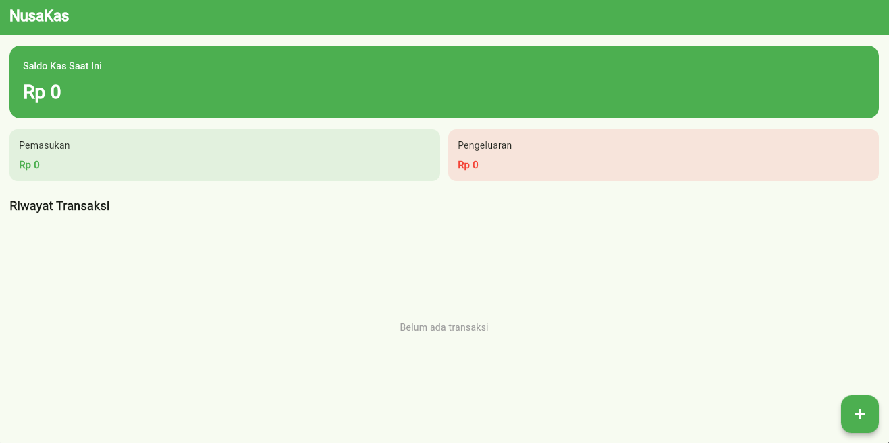
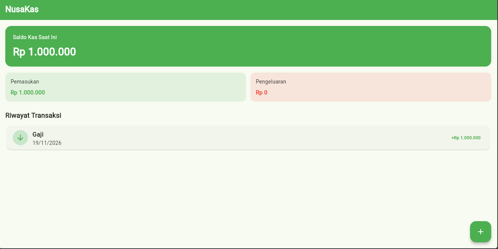
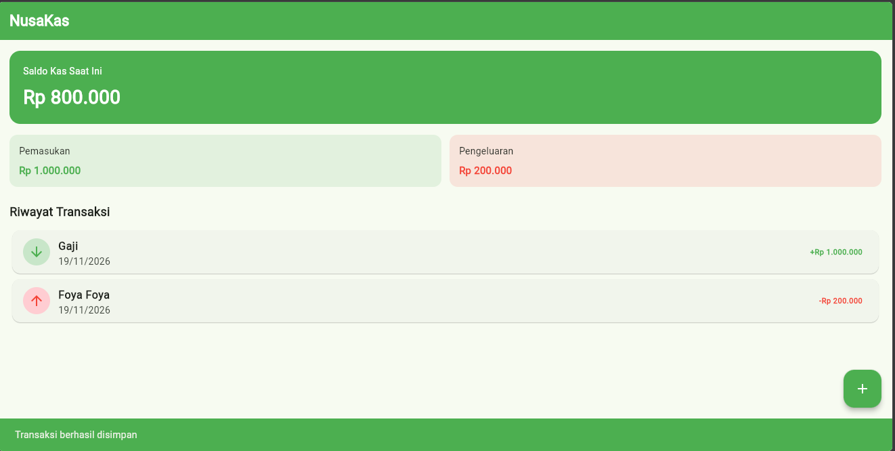
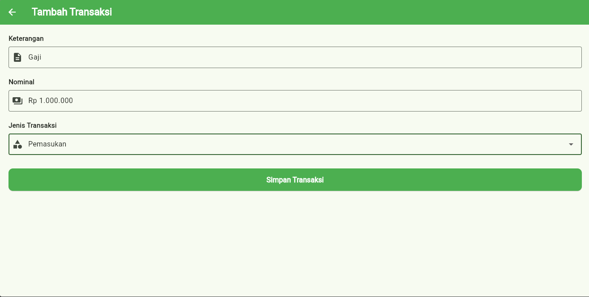
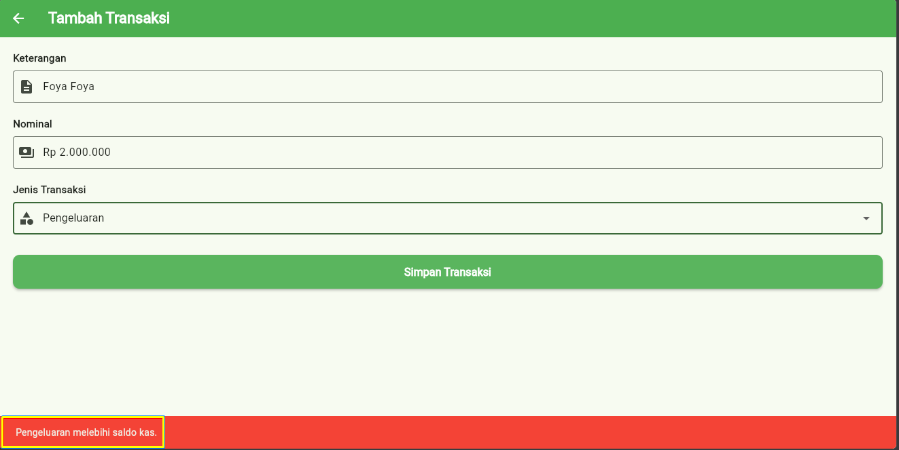
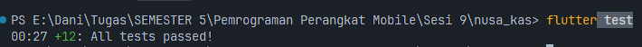
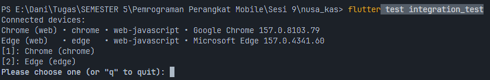

# PPM Sesi 9 - Pengujian Unit dan Integrasi

## Identitas

- **Nama:** Mochamad Ramdhan Irawan
- **NIM:** 20240040199
- **Prodi/Kelas:** Teknik Informatika / TI24G

---
## Halaman Utama

  

  

  

---
## Tambah Transaksi

  

  

---
## Flutter Test

  

---
## Integration Test

  

